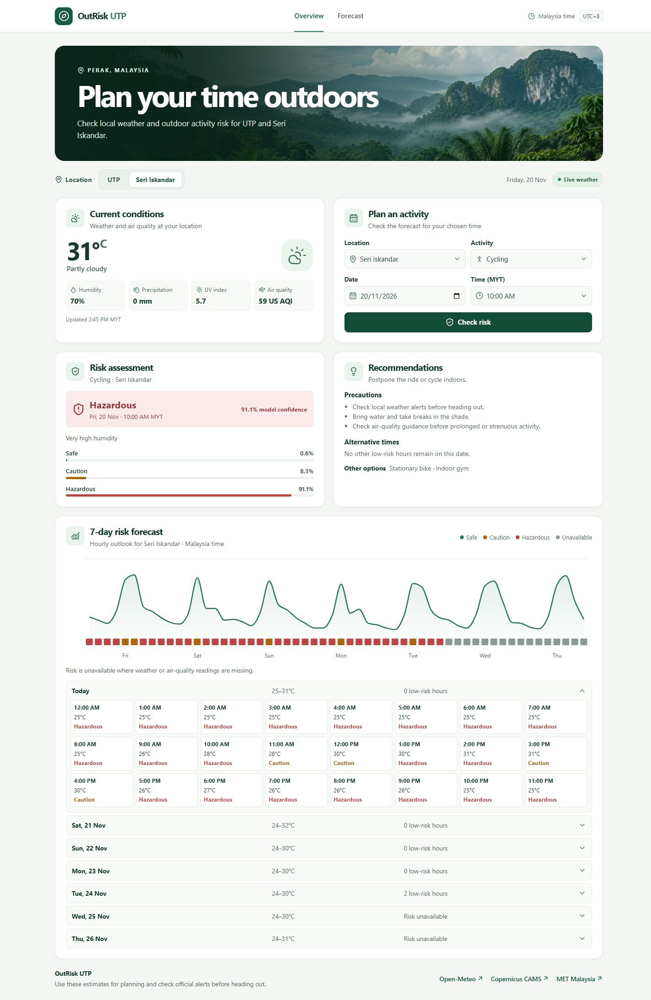

# OutRisk UTP

OutRisk UTP helps people at Universiti Teknologi PETRONAS and in Seri Iskandar plan outdoor activities around forecast weather and air quality. The dashboard shows current conditions, a seven-day outlook, and an activity-specific assessment with precautions and alternative times.



## Run locally

Use Python 3.12, Node.js 22.12 or newer, and pnpm 11. The default Open-Meteo endpoints require an internet connection and work without an API key for non-commercial use.

Start FastAPI from the repository root in PowerShell.

```powershell
cd server
python -m venv venv
.\venv\Scripts\python.exe -m pip install -r requirements.txt
.\venv\Scripts\python.exe -m model.train
.\venv\Scripts\python.exe -m uvicorn main:app --reload --port 8000
```

Start React in a second terminal from the repository root.

```powershell
cd client
pnpm install --frozen-lockfile
pnpm dev
```

Open [the dashboard](http://localhost:5173/) or [the interactive API documentation](http://localhost:8000/docs).

On macOS or Linux, use `./venv/bin/python` in the FastAPI commands. If a live request fails, select **Explore sample weather** in the dashboard to try the workflow with synthetic conditions.

## API

Use `UTP` or `Seri Iskandar` as the location. Weather routes use ISO timestamps in Malaysia time. Prediction requests take `location`, `activity`, `date` as YYYY-MM-DD, and `hour` as an integer from 0 to 23.

| Method | Endpoint | Response |
| --- | --- | --- |
| GET | `/api/health` | API status |
| GET | `/api/weather/current/{location}` | Current weather, UV, US AQI and PM2.5 |
| GET | `/api/weather/forecast/{location}` | 168 hourly weather rows |
| GET | `/api/weather/historical/{location}` | 100 complete calendar days ending yesterday |
| POST | `/api/predict/risk` | Risk class, confidence, probabilities and contributing factors |
| GET | `/api/predict/forecast/{location}` | 168 hourly weather and risk rows, optionally rated for the chosen activity using `?activity=sports` |
| POST | `/api/recommend/activity` | Activity advice, precautions and available alternatives |

Current and forecast endpoints accept `?source=sample`. The two POST endpoints accept `"source": "sample"` in the body. The historical route uses the live archive.

## How risk is estimated

The hourly forecast, activity assessment and alternative times use the same rules. They use Open-Meteo’s feels-like temperature, which combines humidity, wind and solar radiation with air temperature. Humidity is displayed for context.

- **Caution** starts at 35°C feels-like for walking, commuting and the general outlook, and at 32°C for jogging, cycling and outdoor sports. Air temperature from 35°C, ordinary rain or drizzle, fog, UV from 6, or U.S. AQI above 100 also merit caution.
- **Hazardous** applies to forecast thunderstorms, heavy precipitation codes or 10 mm/hour of precipitation, 40°C feels-like or 37°C air temperature, UV of 11 or above, or U.S. AQI above 150.
- **Low-risk hours** have enough readings to assess and meet none of the above conditions.

These thresholds are for hourly planning. MET Malaysia issues official warnings using separate criteria, including multiple days of maximum air temperature for heat waves. OutRisk displays Open-Meteo’s U.S. AQI. Check Malaysia’s Department of Environment for its local IPU readings. [MET Malaysia warnings](https://www.met.gov.my/en/ramalan/ribut-petir/) · [MET Malaysia heat-wave criteria](https://www.met.gov.my/en/pendidikan/fenomena-cuaca/) · [KKM hot-weather guidance](https://infosihat.moh.gov.my/cuaca-panas.html) · [WHO UV guidance](https://www.who.int/news-room/questions-and-answers/item/radiation-the-ultraviolet-%28uv%29-index) · [U.S. AQI guidance](https://www.airnow.gov/aqi/aqi-basics/) · [Malaysia IPU readings](https://eqms.doe.gov.my/APIMS/main/)

The Random Forest learns the rules from synthetic examples. Its score shows how closely it agrees with the rule label. Run `python -m model.train` again from `server/` to update the model after pulling the revised rules. The API can apply the rules while model scores are unavailable.

The weather forecast spans seven days. The air-quality feed may have a shorter horizon. A known severe hazard still shows when other readings are missing. Hours with incomplete readings and no known severe hazard remain unavailable.

Weather and air quality are provided by [Open-Meteo](https://open-meteo.com/). Air-quality forecasts use [Copernicus Atmosphere Monitoring Service](https://atmosphere.copernicus.eu/) data.

Banner photo by [Yogendra Singh on Pexels](https://www.pexels.com/photo/men-playing-soccer-on-field-1375148/), used under the [Pexels License](https://www.pexels.com/license/).

## Verify and build

```powershell
# From server/ after training
.\venv\Scripts\python.exe -m unittest discover -s tests -v

# From client/
pnpm build
```

Build the client, then start FastAPI from `server/` to serve `client/dist` and the API from the same origin on port 8000. Set the Open-Meteo base URLs in `server/.env` as shown in `server/.env.example` if custom endpoints are needed.

```text
outrisk/
├── issue.md              Project brief and roadmap
├── server/
│   ├── main.py           FastAPI entry point
│   ├── data/             Forecast ingestion and preprocessing
│   ├── model/            Training, thresholds and inference
│   ├── routes/           Weather, prediction and advice endpoints
│   └── tests/            Offline regression checks
├── client/
│   ├── public/           Dashboard imagery
│   └── src/              React dashboard and API client
└── docs/                 Dashboard screenshot
```


